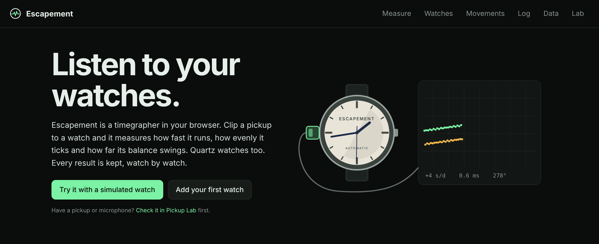
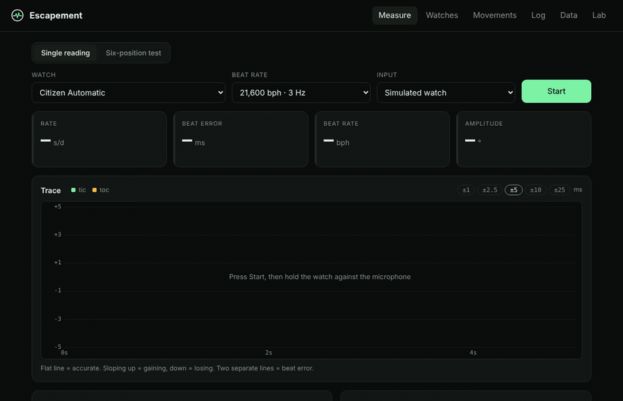
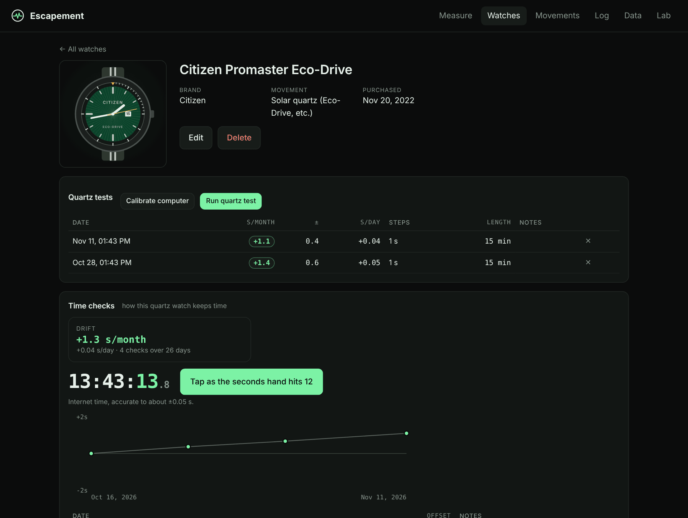
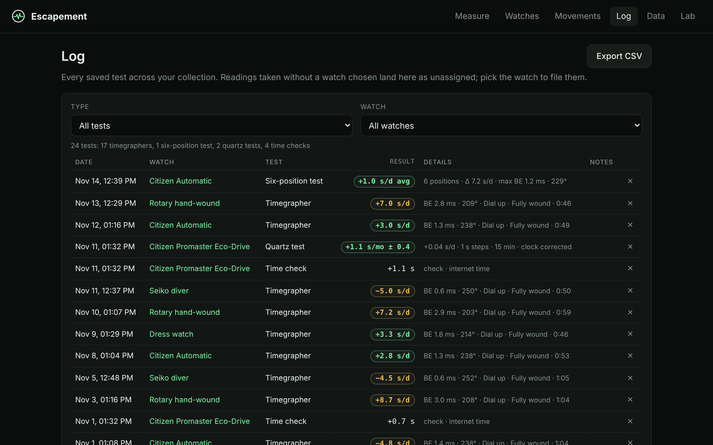

<p align="center">
  
</p>

<h1 align="center">Escapement</h1>

<p align="center">
  <b>A free, open-source timegrapher that runs in your browser.</b><br>
  Clip a pickup to a watch and Escapement listens to it tick: how fast it runs, how evenly it beats, how far its balance swings.<br>
  Quartz watches too. Every test is kept, watch by watch.
</p>

<p align="center">
  <a href="https://escapement-amber.vercel.app"></a>
  
  
  
</p>

<p align="center">
  <a href="#-measure-a-watch">Measure</a> ·
  <a href="#-your-collection">Collection</a> ·
  <a href="#-quartz-watches-too">Quartz</a> ·
  <a href="#-3000-movements">Movements</a> ·
  <a href="#-every-test-logged">Log</a> ·
  <a href="#-pickup-lab">Pickup Lab</a> ·
  <a href="#-getting-a-clean-reading">Tips</a> ·
  <a href="#-under-the-hood">How it works</a>
</p>

---

No app, no account, no hardware beyond a R199 clip-on pickup (or a quiet room and your laptop's mic). Your data stays in your browser, with optional sync across devices. Don't have a watch to hand? There's a **simulated watch** built in, so you can try everything right now.

## 🎧 Measure a watch

<p align="center"></p>

Press **Start** and the classic paper trace draws itself, one dot per tick. Flat means accurate, a slope means gaining or losing, and two separate lines mean beat error.

- **Rate** in s/day, **beat error** in ms, **amplitude** in degrees, and the **beat rate** found for you (14,400 to 36,000 bph)
- **Auto-tune** listens through 12 filter and trigger combinations at once and locks onto whichever hears a clean beat. No sliders.
- **Built for noise:** every tick is shape-matched against the average beat, so a missed click doesn't throw the reading off. Optional noise reduction handles fans and hum.
- **Six-position test:** dial up, dial down and four crown positions, guided, with the average rate and positional delta

## ⌚ Your collection

<p align="center"></p>

Add your watches with photos, calibre and service dates, and each gets its rate-over-time chart (with the COSC band), positional delta and the stored trace of every reading.

No photo? You get what may be **the most over-engineered image placeholder ever**: a face drawn for the watch's movement type, showing the real time and today's date, its seconds hand moving the way that movement does. Quartz steps once a second, a mechanical watch beats at its own beat rate, Spring Drive glides.

And since we'd gone that far, there's a **face designer** too:

<p align="center"></p>

Case shape and metal, dial colour and finish, markers, hands, small seconds, diver or coin-edge bezel, strap or bracelet, date window, power reserve. Anything you leave alone keeps following the watch.

<p align="center"></p>

**Identify with AI, free:** photograph the caseback, movement and dial, and Escapement suggests the brand, reference, calibre, beat rate, lift angle and production date, with sources. Copy the request into the Claude or Gemini app you already use, or use your own free Gemini key. Nothing is billed.

## 🔋 Quartz watches too

<p align="center"></p>

A timegrapher can't read quartz, so Escapement does it another way:

- **Acoustic quartz test:** the seconds hand's stepping motor clicks. Escapement times those clicks for 5 to 20 minutes and gives the rate in **s/month with an honest ±**. It checks your computer's sound-card clock against internet time as it goes, because the sound card can drift more than the watch.
- **Low battery or charge** shows up as 2-second steps, and gets flagged.
- **Time checks:** tap as the seconds hand hits 12, and Escapement compares it with internet time. A few checks give the drift. Mechanical watches get them too, for how they keep time on the wrist.
- **Battery log** for quartz, solar and kinetic watches

## 🔎 3,000 movements

<p align="center"></p>

A searchable reference library of about **3,000 calibres**:

- **About 40 modern workhorses** (ETA, Sellita, Seiko, Miyota, Rolex, Omega and more), each with a cited source and its **lift angle**, which amplitude depends on. Lift angles are only listed where a source documents them, never guessed.
- **Nearly 3,000 more**, many of them vintage Swiss and German, from [Watch Movements Archive](https://watch-movements-archive.com/) by the UHRFORUM.de community, used with permission: beat rate, jewels, size, power reserve, production years and how to identify each one.
- Type a calibre in the watch form ("NH35", "ETA 2824", "Citizen 8200") and its beat rate, type and lift angle fill in.
- Movements you've measured are tagged **Tested**.

Don't know what's inside a watch? **Find the movement** narrows it down by the watch's brand, winding and the beat rate Escapement measured:

<p align="center"></p>

## 📒 Every test logged

<p align="center"></p>

Every valid reading, six-position set and quartz test saves itself the moment it ends, to the watch you chose or to the **Log** to file later. Filter by watch and type, edit notes, export to CSV, or back everything up as JSON.

## 🔌 Pickup Lab

<p align="center"></p>

A companion page at **/lab** for checking a pickup or mic before you measure. It lists every input the browser can see, draws the live level, spectrum and waveform, and runs three quick tests: background noise, a tap test to prove the pickup feeds this input, and a watch test. You get a verdict per input, a comparison table, and one tap to use the winner. It also shows exactly **where to clip the pickup**.

## 💡 Getting a clean reading

- A cheap **piezo contact pickup** beats any built-in mic. Clip it to the case side at 9 (or a lug), sensor pad on bare metal. Not the crown, strap or crystal.
- **Turn the input up.** A piezo on a computer's mic jack is very quiet. Input at 100 plus **Microphone Boost +20 dB** took real ticks from 3× to 10× the background. +30 dB was no better. A Hi-Z input (a USB audio interface's guitar input) suits a piezo best.
- Use the **rear jack** on a desktop: the front panel picks up far more hiss.
- A quiet room, the watch dial up on a soft cloth, cable slack. Wait for two tidy lines, then let it run 30 to 60 seconds.
- Leave **noise reduction** off unless there's a steady hum or whine.
- Quartz clicks are quieter: if the case side doesn't work, press the pad to the centre of the caseback.
- No ticks at all? An automatic left still stops after a day or two. Give it a few gentle swings.
- Microphone access needs HTTPS (or `localhost`).

## 🔬 Under the hood

<details>
<summary><b>How the timing works</b></summary>

```
mic ─► AudioWorklet ──────────────────────────────────────────► main thread
       2× high-pass (2 kHz)                                    beat-rate detection
       envelope + adaptive noise floor                         beat index assignment
       trigger → look back to the first click (sub-sample)     least-squares fit
       = timestamp per tick                                    = rate, beat error, trace
```

In **auto-tune** mode the worklet runs 12 detectors in parallel (high-pass at 1.5, 3 and 6 kHz × four trigger levels). Every ¾ s each stream is scored at every plausible beat rate:

```
score = precision × recall / (1 + jitter / 1.5 ms)
```

A fast O(n) pre-screen picks the candidates worth a full fit. Precision punishes echoes and noise triggers, recall punishes missed beats, and jitter punishes coincidental grids. The best stream wins, with hysteresis so the lock doesn't flicker. Once locked, every detector's dead time widens to ~45% of a beat, which removes echoes from the case or the table.

Ticks are timestamped on the audio thread against the sample clock, so timing isn't affected by UI jank. Each tick gets a beat index *n* and a side (tic/toc). Escapement then fits

```
t = a + b·n + c·s        s = ±½ for tic/toc
rate       = 86400 · (P / b − 1)   s/day     (P = nominal beat period)
beat error = |c|                    ms
```

with robust outlier rejection, so a bump on the table or a missed tick doesn't throw the reading off.

**Shape-matched timing:** the detector stamps each tick where its first click crosses a threshold, but in noise that quiet first click is sometimes missed and the stamp lands on the next click, a few ms late. So every tick is then aligned by normalised cross-correlation (0.1 ms envelope bins, parabolic sub-bin interpolation) against a running template of the beat. Ticks that don't resemble a beat are dropped.

**Amplitude** comes from the lift time: each beat is split into its sub-clicks (unlock, impulse, drop), each timed at half its own peak, and the gap from unlock to drop gives `A = LA / (2·sin(π·t/T))` with the movement's lift angle LA. The median over the window is shown. When the unlock click is too faint to time on single beats, amplitude is read from the **average of a few hundred aligned beats** instead (noise falls by about √n): each tick's envelope snippet starts 24 ms before the loud click, because on real vintage watches the unlock came 13–14 ms before the drop at under a tenth of its height.

**Noise reduction** (optional) is an STFT spectral subtraction ahead of the detectors: 2048-sample frames (fine enough to separate 50 Hz harmonics), 75% overlap, a per-bin background tracker that falls fast and rises slowly, and gain `max(floor, 1 − α·noise/power)`. It is exactly transparent when off.

</details>

<details>
<summary><b>How the quartz test works</b></summary>

With a 400 ms dead time, the same detector bank hears the stepping motor; a fit of `t = a + b·n + c·s` (s = ±1 for the motor's alternating polarity) gives the watch's second. Every 3 s the browser asks `/api/time` for the server's clock, timing the round trip on the sound card's clock (interpolated with `getOutputTimestamp`), and a robust line through (server − sound card) gives the sound card's error in ppm, which is subtracted. Calibrations are stored per output device and combined by inverse variance.

**Audio dropouts:** on a busy computer the browser's audio can stall for a moment: the sound card's clock pauses while real time goes on, and every later click shifts. The quartz test watches the gap between the sound card's clock and the computer's several times a second; a jump that holds is a dropout. Both the rate fit and the clock fit then give each unbroken stretch its own offset and share only the slope, so a test survives stalls instead of reporting nonsense. Clock corrections outside what a real sound card can do (±400 ppm) are never applied, the test uses bigger audio buffers to make stalls rarer, and **Download diagnostics** on the result saves the raw timings for troubleshooting.

</details>

<details>
<summary><b>Online collection (optional sync)</b></summary>

Escapement is local-first: everything lives in your browser and works offline. On a hosted deployment, you can also sign in with GitHub to keep your watches, photos and readings **in sync across devices**, backed up in a **private** Vercel Blob store. Only one GitHub account, the owner's, can sign in.

To set it up on your own Vercel deployment:

1. **Create a private Blob store** in the Vercel project (Storage → Create → Blob, access *Private*). Connecting it adds the storage credentials.
2. **Create a GitHub OAuth app** (GitHub → Settings → Developer settings → OAuth Apps → New):
   - Homepage URL: `https://<your-app>.vercel.app`
   - Authorization callback URL: `https://<your-app>.vercel.app/api/auth/callback`
3. **Add environment variables** to the Vercel project, then redeploy:

   | Variable | Value |
   | --- | --- |
   | `GITHUB_CLIENT_ID` | from the OAuth app |
   | `GITHUB_CLIENT_SECRET` | from the OAuth app (generate a client secret) |
   | `OWNER_GITHUB` | your GitHub username, the only account allowed in |
   | `SESSION_SECRET` | a long random string, e.g. `openssl rand -base64 48` |

How it works: small Vercel Functions in `api/` handle sign-in (a signed, HttpOnly session cookie; no database) and sync. Each record is a JSON document in the private store, and deletions leave a tombstone so they reach other devices. The app tracks local changes with IndexedDB hooks and keeps them on the device until you press **Sync** (in the top bar or on the Data page); a sync pushes them and pulls whatever changed online since the last sync. Sync never runs on a timer, because each one lists the Blob store and that counts against Vercel Blob's advanced-operation quota. The newer version wins.

</details>

<details>
<summary><b>Tuning on real recordings</b></summary>

The **Record 10 s clip** button in the Signal panel (and **Record 60 s** in Pickup Lab, for quartz) saves the raw input as a WAV file. Analyse it offline with exactly the app's pipeline:

```bash
npm run analyze-clip -- escapement-clip.wav [--bph 28800] [--lift 52] [--nr]
npm run analyze-clip -- quartz-clip.wav --quartz
```

It prints what each auto-tune detector heard, which one locked, and the resulting rate, beat error and amplitude (per tick and from the averaged beat). With `--quartz` it finds the stepping motor's clicks, the step length and the rate against the sound card's clock. Recordings of awkward watches are very welcome as issues.

</details>

<details>
<summary><b>The movement data</b></summary>

Escapement's own reference entries live in `src/data/movements.ts`, each with its source. The archive entries in `src/data/archive.json` are built by `scripts/import-archive.ts` from a crawl of Watch Movements Archive (done with the admin's permission), keeping only the facts a timegrapher needs: no photos or descriptions. Every entry links back to its archive page. Cylinder, pin-lever and tuning-fork movements get a note on what a timegrapher can and can't read. **Links & sources** in the app's footer lists every site the data is based on. Each movement also links to [Ranfft DB](https://ranfft.org), the community movement encyclopedia; Escapement doesn't copy Ranfft's data.

</details>

## 🛠️ Development

```bash
npm install
npm run dev        # http://localhost:5173
npm test           # analysis tests against the simulated watch
npm run build      # type-check + production build into dist/
```

Vite and TypeScript with no framework, the Web Audio `AudioWorklet`, and Dexie (IndexedDB). It deploys as a static site to Vercel, Netlify or GitHub Pages.

<details>
<summary>Project layout</summary>

```
src/
  audio/      detector (worklet-safe), simulated watch, worklet, engine
  analysis/   beat-rate detection, fit, trace
  ui/         canvas trace + waveform, SVG history chart
  data/       reference movements (sourced specs, Watch Movements Archive import, caliber matching)
  views/      measure, watches, watch detail/form, movements, data
  sync/       online sync engine and its UI
  lab/        Pickup Lab page
  db.ts       Dexie schema
api/          Vercel Functions: GitHub sign-in, sync, photos (private Blob)
scripts/      offline clip analyser; Watch Movements Archive importer
tests/        detector, analysis, API and sync tests
docs/media/   README screenshots and GIFs
```

</details>

## 🗺️ Status and roadmap

**v0.6, in active use.** Tested on real watches through a clip-on piezo pickup on a desktop's mic jack: a 1970s hand-wound Rotary, a 1976 Citizen automatic and a Citizen Eco-Drive. What those recordings taught (turn the input up, where to clip the pickup, quiet unlock clicks, audio dropouts during long quartz runs) is built into the app.

- [x] Rate, beat error, amplitude, auto beat rate, paper trace
- [x] Guided six-position test
- [x] Watch collection, every test saved, the Log, export and import
- [x] Clip recorder, offline analyser and Pickup Lab
- [x] Tested on real watches with a contact pickup
- [x] Acoustic quartz test with sound-card clock calibration and dropout handling, battery log
- [x] Free AI identification
- [x] Live drawn watch faces and a face designer
- [x] Reference library of ~3,000 movements, Tested tags, Find the movement
- [x] Optional online collection: GitHub sign-in and manual sync across devices
- [ ] Installable offline app
- [ ] Public share page for chosen watches
- [ ] Service-due hints from amplitude trends

## Licence

MIT © Charl Fourie

The movement facts in `src/data/archive.json` come from [Watch Movements Archive](https://watch-movements-archive.com/) and the UHRFORUM.de community, used with the site admin's permission. They aren't covered by the MIT licence; ask the archive before reusing them. Escapement's own reference entries in `src/data/movements.ts` cite their sources.
